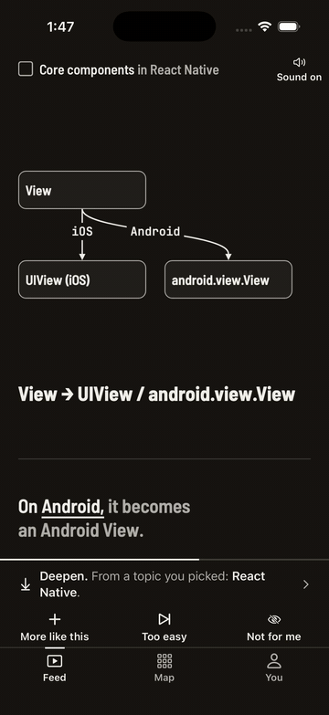
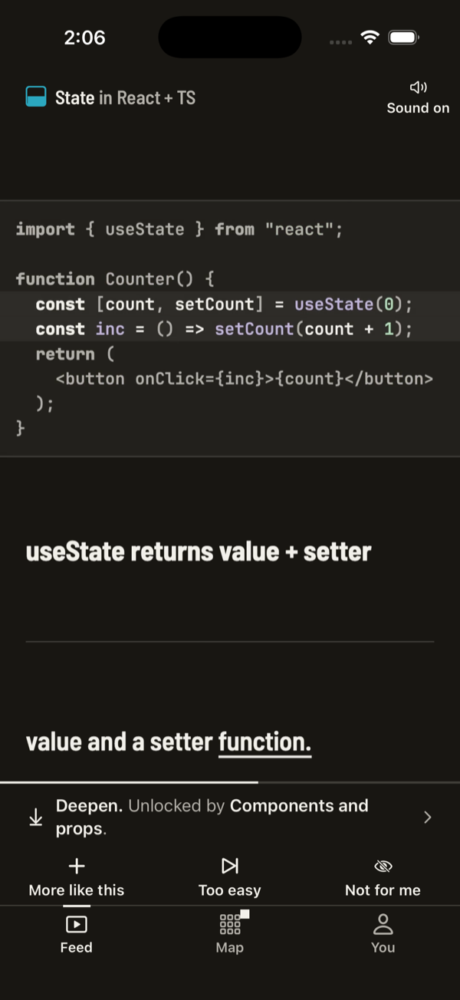
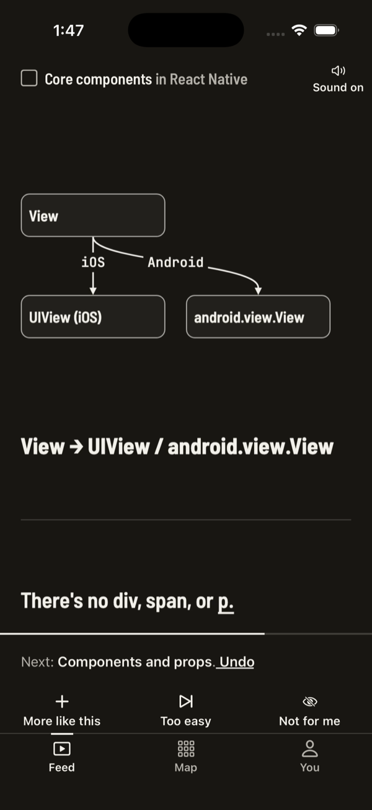
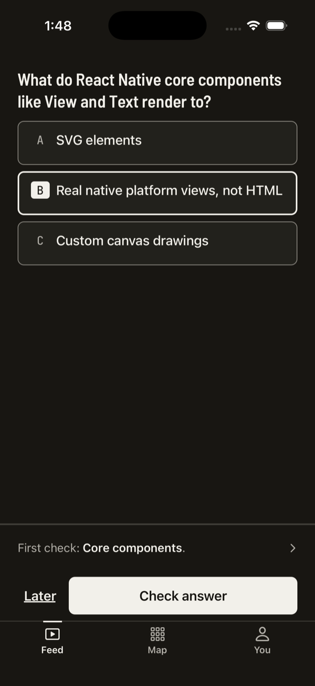
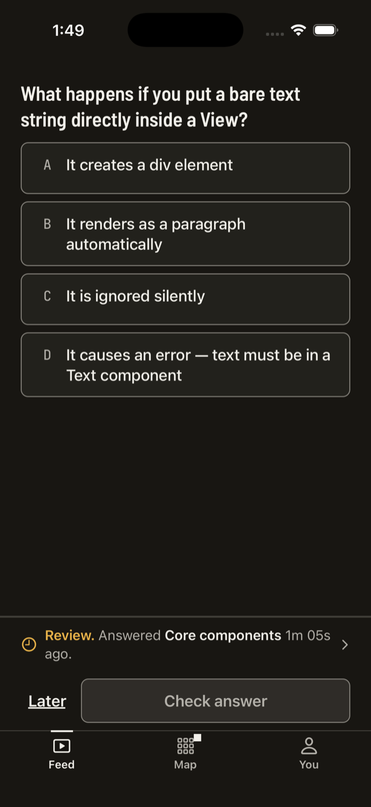
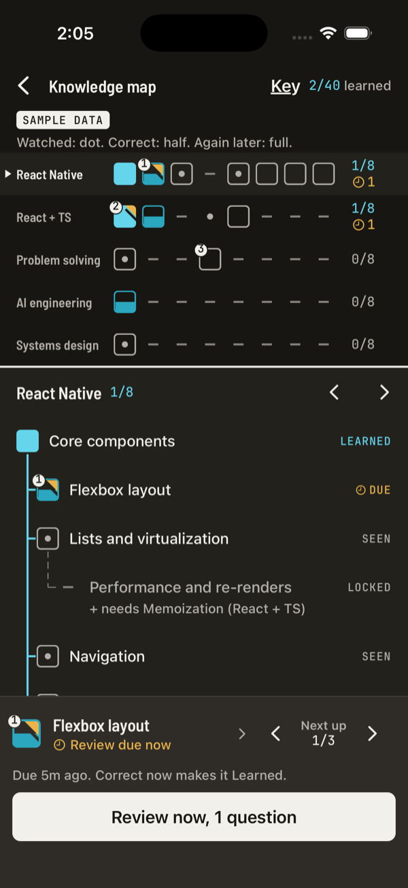
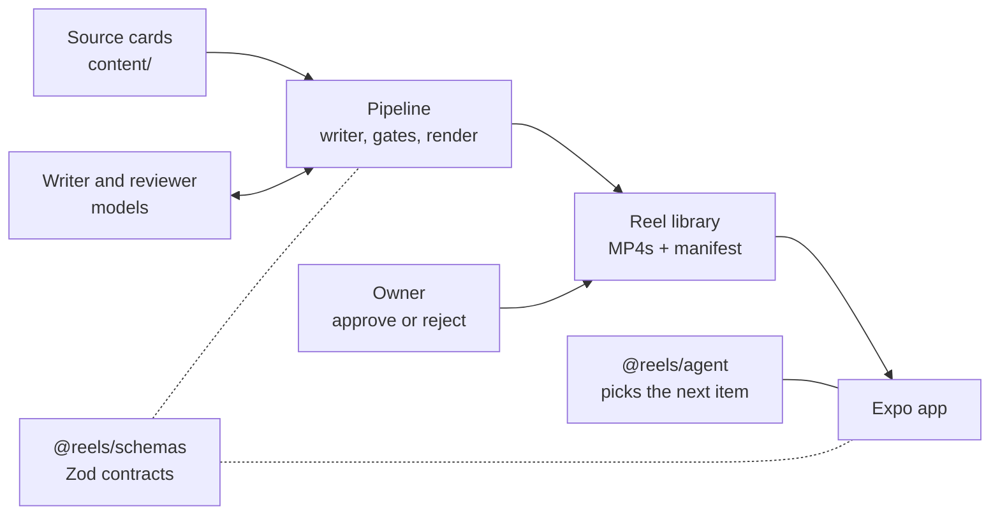

# Adaptive Reels

[](https://github.com/waleedkhaled/adaptive-reels/actions/workflows/ci.yml) [](LICENSE)

A vertical feed of 30-second lesson videos for developers that adapts to what you watch, and only marks a concept learned after you answer a question about it correctly, later. The app is React Native on Expo SDK 57. A deterministic TypeScript agent picks every next item and says why. The 119 lessons come from an LLM pipeline whose reviewer model is measured against planted mistakes.

<p align="center">
  
</p>

<p align="center">
  
  
  
  
  
</p>

## Highlights

- **An agentic content pipeline.** A writer model drafts each lesson from a source card. Free, exact checks run first: the schema, a real TypeScript type-check of every snippet, and verbatim quotes from the card. Then a reviewer from a different model family answers typed questions for grounding, pedagogy and safety; one rewrite with its feedback; then human approval. 119 of 120 lessons passed, for $3.31 in model calls. [Agentic design](docs/AGENTIC_DESIGN.md)
- **The reviewer is measured, not trusted.** A golden set of 16 good specs and 24 planted plausible-but-wrong ones (8 defect types). It catches 67% of the planted defects and passes 94% of the good specs, for $0.23 a run. CI replays the recorded answers offline and fails when a prompt changes without a fresh run. [Evals](docs/EVALS.md)
- **A deterministic on-device agent.** A pure reducer with seeded draws: every pick carries a reason code that the app shows as "why this reel", and the same inputs always give the same feed. 200 unit tests plus randomized session simulations. [Agent API](packages/agent/README.md)
- **A feed built for instant starts.** A pool of three video players, play state switched at 60% visible and heavier work deferred until the swipe settles, the progress line on the UI thread, file-first offline playback. Reel start p95 is 198 ms in production JS on the iOS Simulator. [Performance](docs/PERFORMANCE.md#10-measured-results)
- **Operable.** A per-call cost ledger with a budget cap; retries with exponential backoff, full jitter and `Retry-After`; a prompt version and request hash on every model call; a schema-validated event log with an analysis CLI.

## How it fits together



[Architecture](docs/ARCHITECTURE.md) has the container and component views, sequence diagrams, data contracts and a failure-modes table. Decisions are recorded as [ADRs](docs/adr/README.md).

## Quick start (no API key needed)

Needs Node 22 (`.nvmrc`), npm, and `ffmpeg`/`ffprobe` on `PATH`.

```bash
npm ci
npm test                                                    # 416 tests: agent, schemas, pipeline, and the replayed reviewer eval
npm run simulate                                            # a headless learner session through the agent
npm run pipeline -- generate --dry-run --limit 5            # the pipeline on fake models, network blocked, with a projected cost
npm run eval -- --replay pipeline/evals/results/latest.json # re-score the recorded reviewer eval offline
```

`npm run typecheck`, `npm run lint` and `npm run format:check` complete what CI runs ([ci.yml](.github/workflows/ci.yml)).

## Running the app

The reels are generated, not committed (`library/` is gitignored). To build your own library you need a DeepInfra key; the whole run costs about $3.30.

```bash
cp .env.example .env                  # then add DEEPINFRA_API_KEY
npm run pipeline -- setup             # one time: headless Chrome for rendering (~95 MB)
npm run pipeline -- all               # generate, review, narrate, render; stops at BUDGET_CAP_USD
npm run pipeline -- serve             # the library on port 8090, plus the review report
npm run mobile                        # Metro: open in Expo Go (SDK 57) or press i for the iOS Simulator
```

The app looks for the library on the Metro host at port 8090; set `EXPO_PUBLIC_LIBRARY_URL` in `apps/mobile/.env.local` to use another address. You → "Save all for offline" makes every reel play without the server. For the 3-minute demo: You → Demo clock on → Reset progress → pick React Native ([UX.md](docs/UX.md) section 7).

To install on an iPhone: Xcode 26.4 or newer, the phone connected by cable with Developer Mode on, then `bash apps/mobile/scripts/install-iphone.sh`.

## Pipeline

```bash
npm run pipeline -- all --only caching--intro   # one reel (a concept id selects all three of its reels)
npm run pipeline -- canary                      # checks that G2 rejects a planted false claim
npm run pipeline -- serve                       # review report: approve or reject each reel
npm run pipeline -- approve                     # rebuild manifest.json from your approved reels
npm run eval                                    # the live reviewer eval, about $0.23
npm run analyze -- path/to/log.jsonl            # a tester's exported event log: skip rate, delayed-review accuracy, start latency
```

Stages run in order and skip reels that already have output (`--force` redoes them); one reel failing doesn't stop the others. Every paid call is logged to `library/ledger.jsonl`, and a run stops before any call that would cross its budget cap. Only approved reels reach `manifest.json`; a re-rendered reel goes back to "to review".

## Repo layout

| Path                                | What                                                                                        |
| ----------------------------------- | ------------------------------------------------------------------------------------------- |
| `packages/schemas`                  | `@reels/schemas`: the Zod contract between pipeline and app                                 |
| `packages/agent`                    | `@reels/agent`: the pure learning agent                                                     |
| `packages/tokens`, `packages/fonts` | Design tokens and fonts shared by the app and the video templates                           |
| `pipeline`                          | `@reels/pipeline`: writer, review gates, TTS, rendering, encode gate, report, reviewer eval |
| `apps/mobile`                       | `@reels/mobile`: the Expo app                                                               |
| `content/software-engineering`      | The knowledge graph (40 concepts in 5 subjects) and one source card per concept             |
| `docs`                              | Plan, design, architecture, ADRs, evals, performance ([index](docs/README.md))              |

Workspace packages export TypeScript source directly, so there is no build step.

## Status and limits

- A demo, not a product: it runs in Expo Go and the iOS Simulator, and is not in an app store.
- The owner's approve/reject pass over the 119 reels is still open; reels with known problems are listed in [EVALS.md](docs/EVALS.md#found-while-building-the-set).
- The performance numbers come from the simulator on a Mac, not from a phone.
- How it was built, and what went wrong along the way: [PROCESS.md](docs/PROCESS.md).

Code is MIT-licensed ([LICENSE](LICENSE)); the fonts in `packages/fonts/files/` keep their SIL Open Font License.
