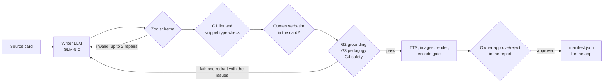

# Agentic design

The project has two agents and a human. Offline, an LLM workflow writes lesson specs and a second model judges them. On the phone, a deterministic policy decides what the feed shows next. The owner approves what ships. This page explains the shape of each loop and why it looks that way. Component detail is in [ARCHITECTURE.md](ARCHITECTURE.md); single decisions are in [adr/](adr/README.md).

## 1. Workflows, not autonomy

A useful line in agent design separates workflows (models and tools on code paths you define) from agents (a model that directs its own process). The content pipeline is deliberately a workflow: a prompt chain with programmatic gates, plus one evaluator–optimizer loop with a hard limit. The task is well defined, so autonomy would add cost and variance without adding capability, and a fixed path makes every step testable, priced and auditable.

Deterministic checks run before model checks: they are free, exact, and they keep the reviewer's attention on what only a model can judge.

## 2. The content workflow

| Step        | Actor                                                       | What it checks                                                                                                                                                                                                                                              | On failure                                                                                                |
| ----------- | ----------------------------------------------------------- | ----------------------------------------------------------------------------------------------------------------------------------------------------------------------------------------------------------------------------------------------------------- | --------------------------------------------------------------------------------------------------------- |
| Draft       | Writer, `zai-org/GLM-5.2`, JSON mode, temperature 0.6       | Writes a spec from the concept's source card. Each key claim must carry a verbatim quote from the card.                                                                                                                                                     | n/a                                                                                                       |
| Repair      | Code ([writer.ts](../pipeline/src/writer.ts))               | JSON parse and the `ReelSpec` Zod schema                                                                                                                                                                                                                    | Errors go back to the writer, up to 2 repairs                                                             |
| G1          | Code ([gates.ts](../pipeline/src/gates.ts))                 | Spoken length for the target duration, narration a TTS voice can read, code size, a real TypeScript type-check of ts/tsx snippets (`compiles` or `should_error`), valid flow diagrams, image prompts without text                                           | Issues go to the redraft                                                                                  |
| Quote check | Code (`quoteProblems`)                                      | Every claim's quote is a verbatim span of the card                                                                                                                                                                                                          | Same                                                                                                      |
| G2          | Reviewer, `deepseek-ai/DeepSeek-V4-Pro-0813`, temperature 0 | Each claim supported, unsupported or contradicted by the card; which choice answers each quiz item (an answer-key check that allows "none"); facts in the script the card lacks; code that doesn't match its narration; bugs in code shown as good practice | Same                                                                                                      |
| G3          | Reviewer                                                    | A 7-item pedagogy rubric, 1 to 5: every item at least 3, mean at least 3.5                                                                                                                                                                                  | Same                                                                                                      |
| G4          | Reviewer                                                    | Insecure practice shown as normal, inappropriate content, risky image prompts                                                                                                                                                                               | Same                                                                                                      |
| Redraft     | Writer                                                      | One rewrite with every issue listed (evaluator–optimizer)                                                                                                                                                                                                   | A second failure rejects the reel                                                                         |
| Approve     | The owner, in the review report                             | Video, script, claims with quotes, gate verdicts and evidence                                                                                                                                                                                               | Rejected reels never reach `manifest.json`; a re-render resets the decision (keyed to the video's sha256) |

Across the library, 119 of 120 reels passed and the whole run cost $3.31 in model calls.

## 3. Why the reviewer answers typed questions

The reviewer never writes a free-text verdict. Each gate sends named questions of three types: `choice`, `score` (1 to n) or yes/no, each answered with a confidence and a short evidence quote ([reviewer.ts](../pipeline/src/reviewer.ts)). Code turns answers into pass or fail, which gives three properties:

- **Thresholds live in code.** "A yes/no flag fails at confidence 0.5", "rubric items need 3 of 5" are reviewable lines, not prompt wording.
- **Recorded answers can be re-scored.** Changing a threshold doesn't need new model calls: the eval replays recorded answers through the current gate code (section 6).
- **Backends are swappable.** Any model that can answer typed questions can stand in. The interface was shaped for TypeSafe's Jev, which natively returns typed answers with probabilities; that comparison is still open.

The reviewer comes from a different model family than the writer, so the two are less likely to share blind spots or to favour their own phrasing.

## 4. Guardrails

- **Cost.** Every paid call reserves its worst-case cost before it starts, so the run stops before the call that would cross the budget cap, and calls in flight count against it ([ledger.ts](../pipeline/src/ledger.ts)). A dry run uses fake providers at real prices and projects the cost of the real run.
- **Network.** Dry runs replace `fetch` with one that throws. The offline stages (layout, render, encode gate, report) may only reach loopback ([network.ts](../pipeline/src/network.ts)).
- **Retries.** Exponential backoff with full jitter, the provider's `Retry-After` when present (with a ceiling), and no retry for 4xx errors that retrying can't fix ([retry.ts](../pipeline/src/retry.ts)). Each ledger entry records how many attempts a call took.
- **Failure isolation.** One reel failing a stage doesn't stop the others; only the budget stops the run.
- **Idempotency.** Stages skip reels that already have output, so a rerun pays only for what's missing.

## 5. Provenance and observability

Every model call writes one ledger line: model, prompt version, a sha256 of the exact request, tokens, cost, latency and attempts. Every text record names the writer and reviewer models and the prompt versions that produced and judged it ([store.ts](../pipeline/src/store.ts)).

A prompt version is the hash of the template rendered for a fixed placeholder input ([provenance.ts](../pipeline/src/provenance.ts)). Any change to wording, rules, repair messages or the embedded JSON Schema yields a new version, with no version number for anyone to forget to bump.

On the phone, the app writes an event log (SQLite in WAL mode) whose schema lives in `@reels/schemas` next to the pipeline's. Testers export it, and `npm run analyze` reports skip rate, delayed-review accuracy and reel start latency.

## 6. Evaluating the reviewer

The reviewer is an agent that makes accept/reject decisions, so it gets measured like one: a golden set of 16 good specs and 24 planted plausible-but-wrong ones (8 defect types), with recall and specificity per gate and cost per run. CI replays the recorded answers offline, and fails when a prompt has changed since the last live run. Method and results: [EVALS.md](EVALS.md).

## 7. The on-device agent

`@reels/agent` decides each next item: a reel, a retrieval card or a session summary. It is a policy, not a language model:

- **Interest moves only from behaviour** (completion, rewatch, early skip, the quick actions). **Mastery moves only from answers.** "Learned" needs a correct answer after a delay, so watching never counts as knowing.
- **Rules first, then a weighted draw.** Reteach after a miss, a "prove it" card after "Too easy", an overdue-review guard, a card cadence, echo after "More like this", a change of pace after two early skips; otherwise a seeded draw over four pools (Review, Deepen, Explore, Lateral) weighted by mode.
- **Every decision carries a reason code** that the app renders as the "why this reel" strip. Explanations come from the decision itself, not from a second model describing it afterwards.
- **Pure and replayable.** `(state, catalog, now) → Step`, with random draws keyed to `(seed, ordinal, purpose)`. Lint bans `Date.now` and `Math.random` in the package. The same inputs give the same feed, which is what makes its 200 unit tests and the randomized session simulations possible.

Why no LLM at runtime: the decision budget is milliseconds per swipe and must work offline; a per-swipe model call costs money at scale; a pure policy can be unit-tested and replayed; and the content it chooses from was already vetted offline. Language models do the open-ended work offline, where latency and review are affordable.

## 8. Known gaps

- The production reviewer passed a factual error in a code reel (`rubber-duck-debugging--example`: the narration says the code crashes; it returns NaN). A person found it. The eval exists because of this class of miss.
- The eval's good specs were checked against their source cards, but the owner hasn't approved them in the review report yet.
- The source cards themselves were drafted during development and haven't been checked independently (owner's call, 2026-10-03), so a claim can be faithful to its card and still be wrong.
- One reviewer model, one call per gate: no second opinion or voting on borderline answers.
- The DeepSeek-versus-Jev reviewer comparison planned in PLAN.md hasn't been run.
