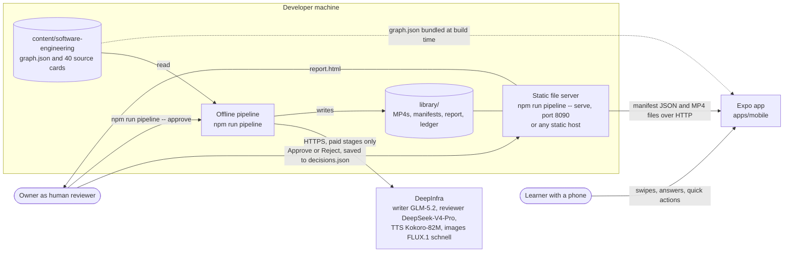
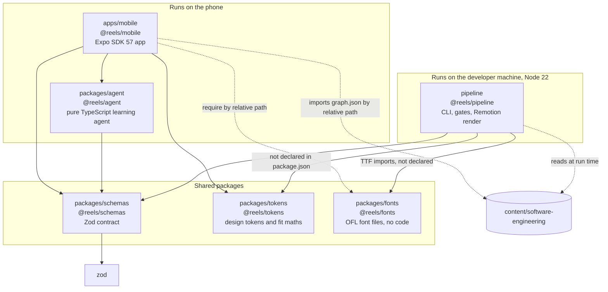
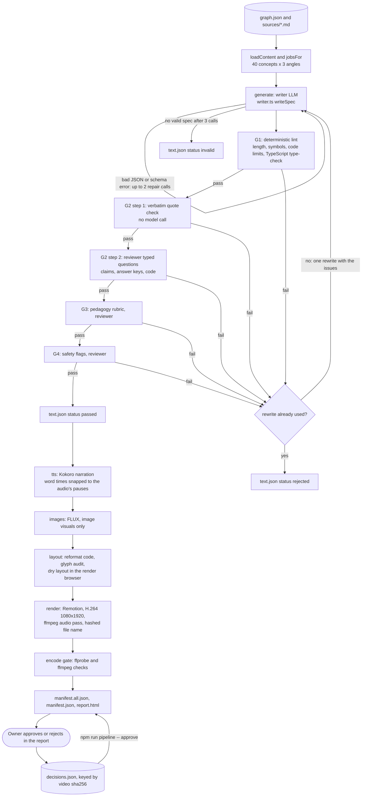
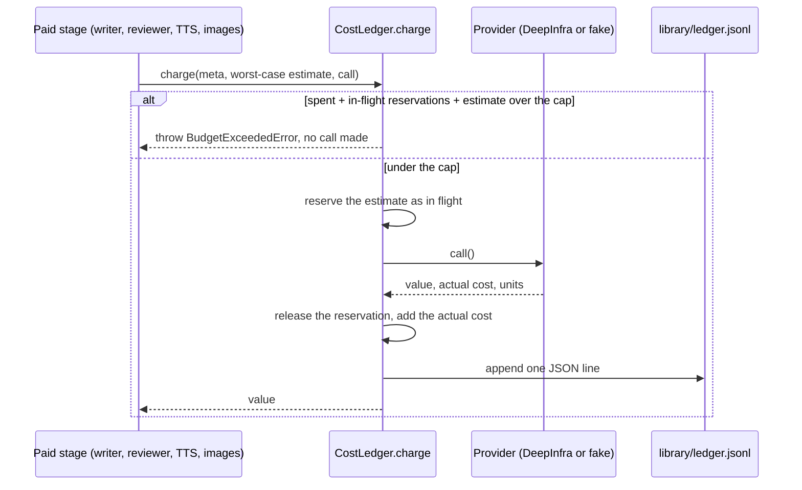
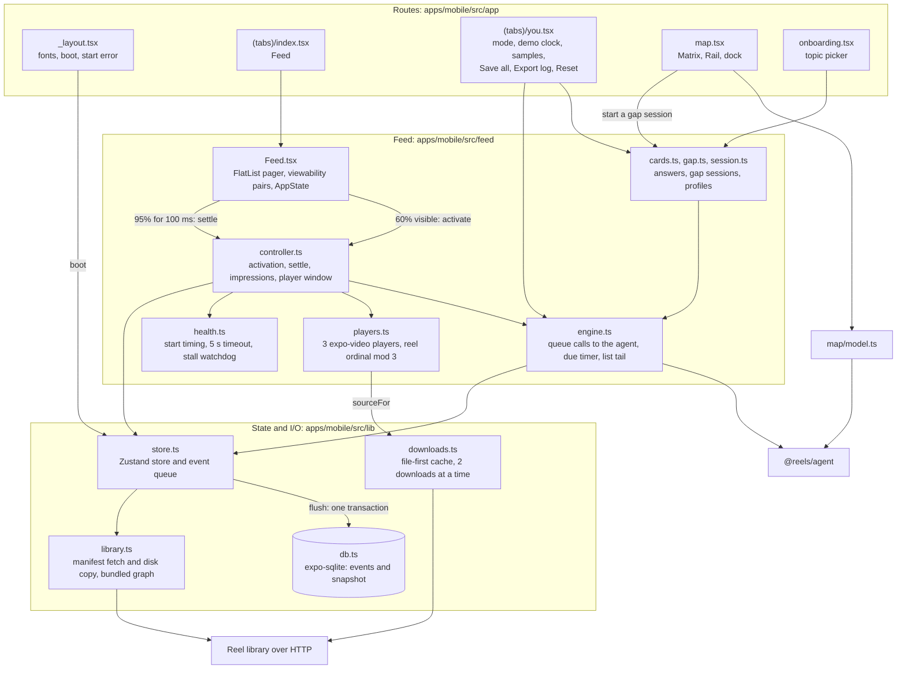
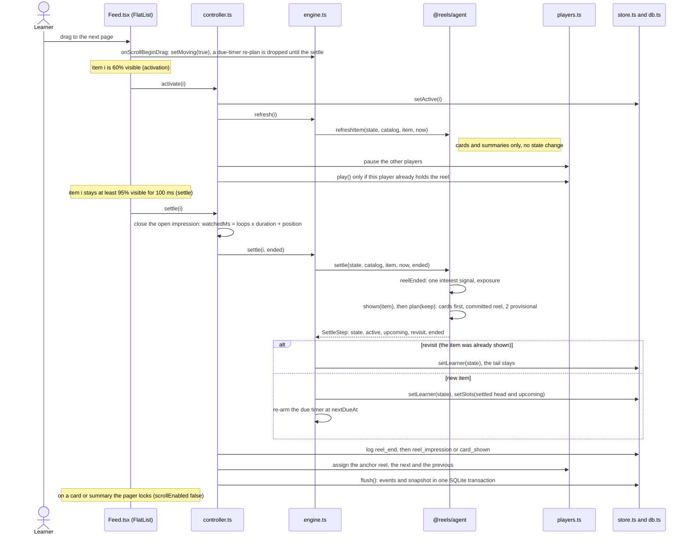
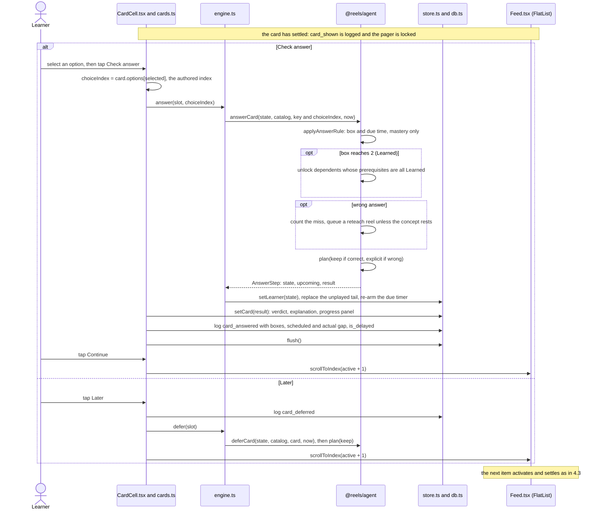

# Architecture

Adaptive Reels is a demo of an adaptive learning feed for developers: short lesson videos ("reels") in a vertical pager, mixed with retrieval questions, over a knowledge graph of 40 concepts in 5 topics. It has three parts. An offline Node pipeline (`pipeline/`) turns the graph and one source card per concept into reviewed, rendered MP4 files and a manifest. It calls hosted models on DeepInfra, every paid call goes through a cost ledger, and the owner approves or rejects each reel before it reaches production builds. A pure TypeScript learning agent (`packages/agent`) picks the next item from the learner's state, takes time and a seed as inputs, and attaches the reason code of the rule that fired. An Expo React Native app (`apps/mobile`) plays the feed, calls the agent when a page settles or a question is answered, and keeps the learner state and an event log in SQLite on the phone. Zod schemas in `packages/schemas` are the contract between the parts. No model runs while the app is in use.

**How to read this.** The sections go from the outside in, in the C4 style: system context, containers, then components of the pipeline and of the app, then the data contracts, failure modes and trade-offs. Decisions are recorded as ADRs in [adr/](adr/README.md). Paths are relative to the repo root. Line numbers were checked on 2026-10-05; files under `pipeline/` were being edited that day, so they are cited by function name instead.

Contents: [1 System context](#1-system-context) · [2 Containers](#2-containers) · [3 Pipeline](#3-pipeline-components) · [4 App](#4-app-components) · [5 Data contracts](#5-data-contracts) · [6 Failure modes](#6-failure-modes) · [7 Trade-offs](#7-trade-offs) · [8 Decisions](#8-decision-records)

## 1. System context

| Actor or system       | Role                                                                                                                                                                                                                                                                                                    |
| --------------------- | ------------------------------------------------------------------------------------------------------------------------------------------------------------------------------------------------------------------------------------------------------------------------------------------------------- |
| Learner               | Swipes, answers questions, taps quick actions. Has no account; profile and event log stay on the phone (`apps/mobile/src/lib/db.ts`).                                                                                                                                                                   |
| App                   | Reads the manifest and MP4s from the library URL (`EXPO_PUBLIC_LIBRARY_URL`, else the Metro host on port 8090: `apps/mobile/src/lib/library.ts:30`). Development builds read `manifest.all.json`, production builds `manifest.json`, unless `EXPO_PUBLIC_REEL_SET` says otherwise (`library.ts:18-24`). |
| Reel library          | Static files in `library/` (gitignored). `npm run pipeline -- serve` serves them with byte ranges and saves review decisions (`pipeline/src/serve.ts`). Any static host works for playback.                                                                                                             |
| Offline pipeline      | `npm run pipeline -- <stage>` (`pipeline/src/cli.ts`). Generates, reviews, narrates, renders and gates reels, then writes the manifests and an HTML report.                                                                                                                                             |
| DeepInfra             | Hosts the four models (`pipeline/src/config.ts` `MODELS`). Called only by the paid stages `generate`, `review`, `tts`, `images` (`run.ts` `PAID_STAGES`) and by `canary` and `eval`.                                                                                                                    |
| Owner, human reviewer | Watches each reel in `report.html`, taps Approve or Reject with an optional note. A decision is stored with the video's sha256 (`pipeline/src/decisions.ts`), so a re-rendered reel goes back to "to review". `npm run pipeline -- approve` rebuilds `manifest.json` from the approved reels.           |

## 2. Containers

Solid arrows are imports by package name; dotted arrows are relative paths or file reads. Nothing imports `apps/mobile` or `pipeline`, the pipeline does not import the agent, and `@reels/schemas` and `@reels/tokens` import no other workspace package. `pipeline/package.json` declares only `@reels/schemas` among the workspace packages; its imports of `@reels/tokens` and `@reels/fonts` resolve through the npm workspace links in `node_modules/@reels/`.

| Container          | Technology                                                                    | Responsibility                                                                                                                                 | Entry points                                                     |
| ------------------ | ----------------------------------------------------------------------------- | ---------------------------------------------------------------------------------------------------------------------------------------------- | ---------------------------------------------------------------- |
| `packages/schemas` | Zod 4                                                                         | Types and runtime validation for reel specs, the graph, the manifest, events and the learner state                                             | `packages/schemas/src/index.ts`                                  |
| `packages/agent`   | TypeScript, no runtime dependencies besides `@reels/schemas`                  | Picks the next feed item, moves interest and mastery, plans gap sessions, produces the copy for reasons and the map                            | `packages/agent/src/index.ts`, API in `packages/agent/README.md` |
| `packages/tokens`  | TypeScript                                                                    | Colours, type, sizes and layout functions (`feedFit`, `mapFit`) shared by the app and the reel templates                                       | `packages/tokens/src/index.ts`                                   |
| `packages/fonts`   | TTF files and their OFL 1.1 licences                                          | Barlow Semi Condensed and JetBrains Mono NL, used by the app and the renderer                                                                  | `packages/fonts/README.md`                                       |
| `pipeline`         | Node 22 with tsx, Remotion 4, ffmpeg and ffprobe, the TypeScript compiler API | Generates, gates, narrates, renders and encode-checks reels; writes manifests and the report; serves the library; analyses exported event logs | `pipeline/src/cli.ts`, `pipeline/src/analyze-log.ts`             |
| `apps/mobile`      | Expo SDK 57, React Native 0.86, Expo Router, expo-video, expo-sqlite, Zustand | The feed, questions, the knowledge map, settings, local persistence and log export                                                             | `apps/mobile/src/app/_layout.tsx`                                |

All packages export TypeScript source (`"main": "src/index.ts"`); Metro, Vitest and tsx compile it, so there is no build step ([ADR 0006](adr/0006-zod-contract-and-source-only-workspaces.md)).

## 3. Pipeline components

### 3.1 Stages

| Stage      | Reads                                       | Writes (under `library/reels/<reel_id>/`)                                   | Paid                      | Skips a reel when                                                                | Code                                                         |
| ---------- | ------------------------------------------- | --------------------------------------------------------------------------- | ------------------------- | -------------------------------------------------------------------------------- | ------------------------------------------------------------ |
| `generate` | graph node, source card, template catalogue | `text.json`: spec, gate results, earlier drafts, status                     | writer, reviewer          | `text.json` exists                                                               | `run.ts` `textStage`, `writer.ts`, `gates.ts`, `reviewer.ts` |
| `review`   | `text.json` spec                            | `text.json` gates and status (no rewrite)                                   | reviewer                  | never: runs on every selected reel that has a spec                               | `run.ts`                                                     |
| `tts`      | passed spec                                 | `timing.json`, `audio/part-N.mp3`                                           | Kokoro                    | `timing.json` exists                                                             | `media.ts` `narrate`, `align.ts`                             |
| `images`   | passed spec                                 | `images.json`, `images/segment-N.*`                                         | FLUX (image visuals only) | `images.json` exists                                                             | `media.ts` `illustrate`                                      |
| `layout`   | text, timing, images                        | `layout.json` (pass, problems, snippet outcomes)                            | no                        | a render run skips reels already rendered with the current templates             | `render/render.ts` `prepareReel`, `openRenderer`             |
| `render`   | laid-out reel                               | `render.json`, `<reel_id>.<sha256[0:12]>.mp4`                               | no                        | `render.json` has the current `RENDER_VERSION`                                   | `render/render.ts`, `render/encode.ts`                       |
| `gate`     | `render.json` and the MP4                   | `gate.json` (checks, sha256)                                                | no                        | the gate already checked this sha256 (and the reel was not rendered in this run) | `encode-gate.ts` `runEncodeGate`                             |
| `report`   | every record                                | `library/manifest.json`, `library/manifest.all.json`, `library/report.html` | no                        | never                                                                            | `manifest.ts`, `report.ts`                                   |

`--force` redoes every selected stage. `all` runs `generate, tts, images, layout, render, gate, report` (`cli.ts`). Reels are processed 4 at a time in the paid stages (`--concurrency`); layout, render and the encode gate run one reel at a time (`run.ts`). Jobs are ordered angle first, so `--limit 5` gives five intro reels of different concepts (`content.ts` `jobsFor`).

The order is cheapest first and stops at the first failure (`gates.ts` `runGates`): G1 needs no model, G2 begins with a string check that also needs none, and G2 to G4 run on text before any audio, image or video is made ([ADR 0004](adr/0004-verbatim-quotes-and-deterministic-checks-first.md)). The writer and the reviewer come from different model families and the reviewer answers typed questions ([ADR 0003](adr/0003-cross-family-reviewer-with-typed-questions.md)).

What reaches the app:

- `manifest.all.json`: every reel whose text passed G1 to G4, rendered with the current templates, whose encode gate passed for exactly that file (`manifest.ts` `shippableReels`, `store.ts` `gatePassed`).
- `manifest.json`: the same, restricted to reels the owner approved for that exact sha256 (`manifest.ts` `buildManifest`, `decisions.ts` `currentDecision`).

### 3.2 Repair loops

| Loop                  | Trigger                                                   | What is sent back                                                     | Limit                                                                                                       | Code                                                            |
| --------------------- | --------------------------------------------------------- | --------------------------------------------------------------------- | ----------------------------------------------------------------------------------------------------------- | --------------------------------------------------------------- |
| Writer schema repair  | reply is not JSON, or `ReelSpec.safeParse` fails          | the previous reply and the Zod issues, formatted as `path: message`   | 3 writer calls per draft; then the record is `invalid`                                                      | `writer.ts` `writeSpec`                                         |
| Reviewer reply repair | reply is not JSON, or an answer does not fit its question | the problems                                                          | 2 calls per gate; then the stage throws for that reel                                                       | `reviewer.ts` `LLMReviewer.ask`                                 |
| Rewrite after review  | any gate fails                                            | the previous draft and every issue, including the reviewer's evidence | 1 rewrite (`MAX_REWRITES = 1`); a second failure leaves the record `rejected`, drafts kept                  | `run.ts` `textStage`                                            |
| Provider retry        | HTTP 408, 429 or 5xx, network error or timeout            | the same request                                                      | 4 attempts; exponential backoff with full jitter capped at 20 s, or the provider's `Retry-After` up to 60 s | `retry.ts` `DEFAULT_RETRY`, `providers/deepinfra.ts` `postJson` |

### 3.3 Cost ledger, idempotence and the dry run

Every paid call is wrapped in `CostLedger.charge` (`pipeline/src/ledger.ts`): the call reserves a worst-case estimate first and is never made when the reservation would cross the cap ([ADR 0005](adr/0005-cost-ledger-and-dry-run.md)).

- **Cap.** `--budget`, else `BUDGET_CAP_USD`, else $10 (`cli.ts`, `config.ts` `DEFAULT_BUDGET_CAP_USD`). The cap applies to one run: each run starts a new ledger at $0.
- **Idempotent stages.** Each stage writes one JSON record per reel (`store.ts` `writeRecord`) and skips reels that have it, so a rerun pays only for missing work. Rendered files are named by content hash, and the encode gate and the owner's decision are tied to that hash. The render record carries `RENDER_VERSION`, which is bumped by hand when the templates or the encode change, so older renders count as stale (`store.ts` `isCurrentRender`). The text stage does not track its inputs: after a source card changes, existing specs stay until `generate --force` replaces them, and their gate results stay until `review` re-runs the gates.
- **Offline stages.** When no paid stage is requested, `guardNetwork` lets fetch and http reach loopback only (Remotion's own server and browser) and refuses https (`pipeline/src/network.ts`).
- **Dry run.** `--dry-run` swaps in fake providers that return deterministic output and price their calls with the real backends' estimators, replaces `globalThis.fetch` with a function that throws, and writes to `library/dry-run/` (`providers/fake.ts` `fakeProviders`, `blockNetwork`; `run.ts`). The CLI then prints the projected worst-case cost. The render stage still runs Remotion locally.

### 3.4 Review and serving

`npm run pipeline -- serve` (`pipeline/src/serve.ts`) serves `library/` on `0.0.0.0` (port `PORT` or 8090) with HTTP range requests, `Cache-Control: immutable` for hashed videos and `no-cache` for everything else, and refuses paths outside `library/`. The report posts decisions to `/api/decisions`, which writes `library/decisions.json` by write-then-rename (`decisions.ts` `writeDecisions`). The app uses the same server as its reel library during development.

`npm run pipeline -- canary` checks the claims gate on a fixture spec: the control must pass G2 and a copy with a planted false claim that still quotes the card verbatim must fail it (`pipeline/src/canary.ts`). The reviewer eval (`npm run pipeline -- eval`) is described in [EVALS.md](EVALS.md).

## 4. App components

### 4.1 Overview

- **Store** (`apps/mobile/src/lib/store.ts`). One Zustand store holds the learner state, the pager's `slots` (the agent's feed items), `activeIndex` (set at activation) and `settledIndex` (set at settle), which reel each player has loaded, settings and the queue of unwritten events. `flush()` writes the queued events and a snapshot of settings, profile and learner state in one SQLite transaction and is not awaited (`store.ts:185-202`, `db.ts:60-81`).
- **Engine** (`apps/mobile/src/feed/engine.ts`). Every queue call to the agent goes through it: it adds `Date.now()`, stores the returned state and replaces the pager's unplayed tail with the agent's plan; items up to the highest settled index never change (`engine.ts:63-74`). It owns the single due timer: one `setTimeout` at `nextDueAt` that re-plans with `plan(..., 'keep')` (`engine.ts:77-92`). The map reads the agent directly for display (`map/model.ts`: `displayState`, `mapCounts`, `mapChanges`, `suggestions`, `gapPlan`, `markMapSeen`).
- **Controller** (`apps/mobile/src/feed/controller.ts`). Activation changes play state only (`controller.ts:140-164`). Settle closes the open impression, calls the engine, logs, assigns players around the anchor reel and flushes (`controller.ts:250-312`).
- **Players** (`apps/mobile/src/feed/players.ts`). Three players created once; reel ordinal `k` always uses player `k % 3`, so the previous, current and next reels hold different players whether or not cards sit between them. Loads are serialised per player and only the latest request may finish ([ADR 0008](adr/0008-feed-playback-pager-and-player-pool.md)).
- **Downloads** (`apps/mobile/src/lib/downloads.ts`). A reel plays from `file://` when its cached file has the manifest's byte count; otherwise it streams from the URL while a download is queued. "Save all for offline" in You queues every reel; files the manifest no longer lists are deleted at boot.

### 4.2 Agent calls by UI event

| UI event                                             | App code                                                 | Agent call                                                                         | Logged                                        |
| ---------------------------------------------------- | -------------------------------------------------------- | ---------------------------------------------------------------------------------- | --------------------------------------------- |
| Onboarding done                                      | `session.ts` `startProfile`, `engine.createProfile`      | `createProfile`, then `startSession`                                               | `session_start`, `onboarding_done`            |
| Cold start, or back after 30 minutes away            | `session.ts` `resumeProfile`; `Feed.tsx` on foreground   | `sessionExpired` (on foreground), `startSession`                                   | `session_start`                               |
| A card or summary comes on screen (activation)       | `engine.refresh`                                         | `refreshItem` (pure, no state change)                                              |                                               |
| A page settles                                       | `controller.settle`, `engine.settle`                     | `settle(state, catalog, item, now, { ended })`                                     | `reel_end`, `reel_impression` or `card_shown` |
| More like this, Too easy, Not for me; Undo           | `Chrome.tsx`, `engine.quickAction` and `undoQuickAction` | `quickAction`, `undoQuickAction`                                                   | `quick_action`, `quick_action_undone`         |
| Check answer                                         | `cards.ts` `checkAnswer`, `engine.answer`                | `answerCard`                                                                       | `card_answered`                               |
| Later                                                | `cards.ts` `leaveCard`, `engine.defer`                   | `deferCard`                                                                        | `card_deferred`                               |
| Due timer fires                                      | `engine.ts` `armDueTimer`                                | `nextDueAt`, `plan(..., 'keep')`                                                   |                                               |
| Mode or demo clock in You                            | `engine.setMode`, `engine.setClock`                      | `setMode`, `setClock`                                                              | `mode_changed`, `clock_changed`               |
| Session ends with a reel open; Skip on a failed reel | `controller.endSessionImpression`, `skipFailed`          | `reelEnded` with `endedBy: 'blur'` or `'skip_failed'`                              | `reel_end`                                    |
| Map opened, concept selected, map closed             | `map/model.ts`, `app/map.tsx`                            | `displayState`, `mapCounts`, `mapChanges`, `suggestions`, `gapPlan`, `markMapSeen` | `map_opened`                                  |
| Gap session started or left                          | `gap.ts`, `engine.startGap`, `engine.leaveGap`           | `startGapSession`, `leaveGapSession`                                               | `gap_session_started`, `gap_session_ended`    |

The full mapping, with return values, is in [packages/agent/README.md](../packages/agent/README.md).

### 4.3 Learner swipes to the next item

The thresholds are the two `viewabilityConfigCallbackPairs` in `apps/mobile/src/feed/Feed.tsx:71-86`. The re-plan keeps the committed reel (the next unplayed reel, already assigned to a player) and places due cards directly after the item on screen, so a re-plan costs no player work unless the next reel changes (`packages/agent/src/queue.ts:209-243`). A flick that passes over planned items never settles on them; their ordinals are used up so no later item reuses a key or a player slot (`queue.ts:317-328`).

### 4.4 Learner answers a card

Code: `apps/mobile/src/feed/cards.ts:52-127`, `packages/agent/src/queue.ts:679-851`, `packages/agent/src/mastery.ts:30-70`. A one-card review started from the map has nothing after it, so Continue returns to the map instead (`cards.ts:120-123`).

### 4.5 Persistence

One expo-sqlite database, `reels.db` (`apps/mobile/src/lib/db.ts`):

- `events`: append-only rows `(seq, at, session_id, type, json)`. Reset progress keeps them; You → Export log writes them as JSON Lines and opens the share sheet.
- `snapshot`: one row holding settings, profile and the agent's `LearnerState` as JSON, with `SNAPSHOT_VERSION` (2). A snapshot with another version, or a learner that fails `LearnerState.safeParse`, starts over at onboarding (`db.ts:35-43`, `store.ts:127-131`).
- The database is opened synchronously at boot with WAL, `synchronous = NORMAL` and `busy_timeout = 3000`. Every later write goes through one promise chain on one connection (`db.ts:46-81`).

## 5. Data contracts

All five live in `packages/schemas/src/` and are Zod schemas with inferred TypeScript types ([ADR 0006](adr/0006-zod-contract-and-source-only-workspaces.md)). Versioned top-level schemas carry `schema_version: 1` (`common.ts:4`).

| Schema                                          | Shape                                                                                                                                                                                                                                                                                                                                                                                                                      | Producer                                                                                                         | Consumers                                                                                                  | Parsed at runtime                                                                                               |
| ----------------------------------------------- | -------------------------------------------------------------------------------------------------------------------------------------------------------------------------------------------------------------------------------------------------------------------------------------------------------------------------------------------------------------------------------------------------------------------------- | ---------------------------------------------------------------------------------------------------------------- | ---------------------------------------------------------------------------------------------------------- | --------------------------------------------------------------------------------------------------------------- |
| `ReelSpec` (`reel-spec.ts`)                     | One reel's script: hook, 1 to 8 segments (narration, on-screen text, a visual: `kinetic_text`, `code`, `flow`, `image` or `equation`), `key_claims` with a verbatim `quote`, `sources`, 1 to 3 retrieval items. Cross-field rules: `reel_id` is `<concept_id>--<angle>`, claim sources exist, claim ids are unique, items cite existing claims, the answer index is in range, choices are distinct (`reel-spec.ts:65-143`) | The writer LLM, through `pipeline/src/writer.ts` `writeSpec`                                                     | Gates (`gates.ts`), narration (`media.ts`), render props, `manifest.ts` (transcript, on-screen text, code) | `ReelSpec.safeParse` in `writeSpec` and after code reformatting (`render/reformat.ts`)                          |
| `KnowledgeGraph` (`graph.ts`)                   | Domain, topic and concept nodes; `PREREQUISITE_OF`, `PART_OF` and `RELATED_TO` edges. `graphProblems` requires one domain, exactly one `PART_OF` parent per node, symmetric `RELATED_TO`, acyclic prerequisites and no unknown ids (`graph.ts:31-106`)                                                                                                                                                                     | The committed file `content/software-engineering/graph.json`                                                     | `pipeline/src/content.ts`, the app (bundled), the agent's `buildCatalog`, the simulator                    | `KnowledgeGraph.parse` in `pipeline/src/content.ts` and at module load in `apps/mobile/src/lib/library.ts:9`    |
| `Manifest` (`manifest.ts`)                      | `generated_at`, `domain_id`, `graph_sha256` and the reels: hashed `url`, `duration_s`, `bytes`, `sha256`, word captions, retrieval items, transcript, on-screen text, code, video size. Reel ids are unique                                                                                                                                                                                                                | `pipeline/src/manifest.ts` `buildManifest`, as `manifest.all.json` and `manifest.json`                           | The app (`lib/library.ts`, `lib/downloads.ts` checks `bytes`), the agent's `buildCatalog`                  | `Manifest.parse` before writing (pipeline) and after every fetch or disk read (app, `library.ts:60,73`)         |
| `LearnerEvent` (`events.ts`)                    | A discriminated union on `type`; every event has `id`, `session_id` and `at`                                                                                                                                                                                                                                                                                                                                               | The app: `store.ts` `log()` queues it, `flush()` writes it to the `events` table, You → Export log exports JSONL | `pipeline/src/analyze-log.ts` (`npm run analyze -- <log.jsonl>`)                                           | Not when written (the app relies on the TypeScript type); `LearnerEvent.safeParse` per line in `analyze-log.ts` |
| `LearnerState`, `FeedItem` (`learner-state.ts`) | Settings, onboarding, interest, mastery, exposure, sticky unlocks, per-reel and per-item counts, ordinals, the session, pending rule items, the queue, the Undo record, the map snapshot and the gap session. `FeedItem` is a reel, card or summary with a stable `key`, `pool` and `reason` (`learner-state.ts:55-112,293-330`)                                                                                           | `@reels/agent`: `createProfile` and every queue call                                                             | The agent (input to every call); the app (renders `FeedItem`s as pager pages, persists the snapshot)       | `LearnerState.safeParse` at app boot (`apps/mobile/src/lib/store.ts:130`)                                       |

Pipeline-internal formats are not in `@reels/schemas`: the per-reel records under `library/reels/<reel_id>/` (TypeScript interfaces in `pipeline/src/store.ts`), `library/decisions.json` (a Zod schema in `pipeline/src/decisions.ts`) and `library/ledger.jsonl` (`LedgerEntry` in `pipeline/src/ledger.ts`).

Five event types exist in the schema but the app does not log them yet: `map_topic_selected`, `map_cell_tapped`, `swipe_frames`, `agent_next` and `replan_ready`. The manifest's `graph_sha256` is written by the pipeline but not compared with the app's bundled `graph.json`; `buildCatalog` drops manifest reels whose concept is unknown and lists them in `catalog.problems` (`packages/agent/src/catalog.ts:146`).

## 6. Failure modes

| Failure                                                              | How it is detected                                                                                                                                               | What happens                                                                                                                                                                                                                                                                                                                      | Where in code                                                                                                         |
| -------------------------------------------------------------------- | ---------------------------------------------------------------------------------------------------------------------------------------------------------------- | --------------------------------------------------------------------------------------------------------------------------------------------------------------------------------------------------------------------------------------------------------------------------------------------------------------------------------- | --------------------------------------------------------------------------------------------------------------------- |
| Provider HTTP 408, 429 or 5xx, network error, timeout                | Response status; `AbortSignal.timeout` (300 s for chat, 120 s for TTS and images)                                                                                | Up to 4 attempts with jittered exponential backoff, or after the provider's `Retry-After`; a `Retry-After` over 60 s fails the call at once. Then the error reaches the reel's stage, which fails for that reel only                                                                                                              | `pipeline/src/retry.ts`; `providers/deepinfra.ts` `postJson`; `run.ts` `isolated`                                     |
| Provider HTTP 4xx other than 408 and 429 (bad request, key, balance) | Response status                                                                                                                                                  | No retry. The reel's stage fails. Each other reel still makes its own call, so a bad key fails every reel one by one                                                                                                                                                                                                              | `retry.ts` `isRetryableStatus`; `providers/deepinfra.ts` `postJson`; `run.ts` `isolated`                              |
| Provider answers without content, word timestamps or a safe image    | Explicit checks after a 200 response                                                                                                                             | `ProviderError` without retry; the reel's stage fails                                                                                                                                                                                                                                                                             | `DeepInfraLLM.complete`, `DeepInfraKokoro.speak`, `DeepInfraFlux.generate`                                            |
| Writer returns malformed JSON or a spec that fails the schema        | `extractJson` throws or `ReelSpec.safeParse` fails                                                                                                               | Up to 2 repair calls with the errors; after 3 calls `text.json` is written with status `invalid` and the problems, and the reel goes no further                                                                                                                                                                                   | `pipeline/src/writer.ts` `writeSpec`; `run.ts` `textStage`                                                            |
| Reviewer returns malformed JSON or an answer that does not fit       | `extractJson` or the per-question Zod schema                                                                                                                     | One repair call; then the stage throws for that reel. No `text.json` is written, so the next `generate` run retries the reel from the start                                                                                                                                                                                       | `pipeline/src/reviewer.ts` `LLMReviewer.ask`; `run.ts` `textStage`                                                    |
| Reviewer rejects a claim (or any gate fails)                         | `GateResult.pass` is false, with issues and the reviewer's evidence                                                                                              | One rewrite with the issues; if it fails again, status `rejected`. Drafts and gate answers stay in `text.json` and show in the report. No audio, image or video is made                                                                                                                                                           | `run.ts` `textStage`; `gates.ts`                                                                                      |
| Budget cap reached                                                   | `CostLedger.charge`: spent (projected in a dry run) plus in-flight reservations plus the estimate exceed the cap                                                 | `BudgetExceededError` before the call. No new reels start, calls in flight finish, the manifests and report are still written when those stages were requested, "Stopped at the budget cap." is printed and the exit code is 2                                                                                                    | `ledger.ts`; `run.ts` `forEachPool` and `run`; `cli.ts`                                                               |
| One reel fails a stage                                               | Any error other than the budget inside a per-reel stage                                                                                                          | Logged as `ERROR <reel_id> <stage>: <message>`; the other reels continue; the failures are listed at the end. The exit code stays 0                                                                                                                                                                                               | `run.ts` `isolated`; `cli.ts`                                                                                         |
| Layout or glyph problem                                              | `LayoutError` from the preparation or the dry layout pass (overflow, fit, glyph audit)                                                                           | `layout.json` records the problems; the reel is not rendered and is listed for manual review                                                                                                                                                                                                                                      | `render/render.ts` `prepareReel`, `openRenderer`; `run.ts`                                                            |
| Render error                                                         | An exception from `renderer.render`                                                                                                                              | The reel is listed in the failures; the remaining reels render, one at a time                                                                                                                                                                                                                                                     | `run.ts`                                                                                                              |
| Encode gate fails                                                    | Checks on the final MP4: container, video, audio, loudness, clipping, ground colour, safe zones, size and length, file hash                                      | `gate.json` records the failed checks; the reel is left out of both manifests. `npm run pipeline -- gate` re-checks                                                                                                                                                                                                               | `encode-gate.ts`; `store.ts` `gatePassed`; `manifest.ts` `shippableReels`                                             |
| Reel re-rendered after the owner's decision                          | The render's sha256 differs from the decision's                                                                                                                  | The decision no longer applies: the reel is "to review" again and leaves `manifest.json`                                                                                                                                                                                                                                          | `decisions.ts` `currentDecision`; `cli.ts` `approve`                                                                  |
| Library server unreachable at app start                              | `fetch` throws or returns a non-2xx status                                                                                                                       | The app uses the manifest saved at the last successful start. Reels saved on the phone play from `file://`; others fail to load (see "A video fails to load"). With no saved manifest, the start error screen shows "Could not load the lessons." and Try again                                                                   | `apps/mobile/src/lib/library.ts:54-77`; `components/StartError.tsx`; `lib/downloads.ts:36-50`                         |
| Empty library                                                        | The manifest has no reels                                                                                                                                        | Start error "No reels yet."                                                                                                                                                                                                                                                                                                       | `apps/mobile/src/lib/store.ts:142-145`; `components/StartError.tsx`                                                   |
| A video fails to load or stalls                                      | Player status `error`, a rejected `replaceAsync`, no first frame 5 s after settle, or the watchdog: `currentTime` unchanged 1 s after `play()` on a ready player | First failure: a file source is deleted and reloaded from the URL, a URL is retried after 1 s; a stalled player is reloaded once and `player_watchdog` is logged. Second failure: the failure state with Try again and Skip, and `reel_load_failed`. Skip closes the impression as `skip_failed`: no interest change, no exposure | `apps/mobile/src/feed/health.ts`; `players.ts:51-79`; `controller.ts:366-380`; `packages/agent/src/interest.ts:35-52` |
| A download is cut short                                              | The downloaded size differs from the manifest's `bytes`                                                                                                          | The `.part` file is deleted and never moved into place; the reel keeps streaming                                                                                                                                                                                                                                                  | `apps/mobile/src/lib/downloads.ts:139-161`                                                                            |
| SQLite write fails or the database is locked                         | The `persist()` promise rejects (after `busy_timeout` 3000 ms)                                                                                                   | The events go back to the queue for the next flush. If the failed batch held a `card_answered`, the strip shows "Could not save your last answer." once. All writes are serialised on one connection                                                                                                                              | `apps/mobile/src/lib/db.ts:46-81`; `lib/store.ts:185-202`                                                             |
| Saved learner state no longer fits the schema                        | Snapshot version differs, or `LearnerState.safeParse` fails                                                                                                      | The profile is dropped and onboarding starts; the event log is kept                                                                                                                                                                                                                                                               | `apps/mobile/src/lib/db.ts:35-43`; `lib/store.ts:127-131`                                                             |
| App backgrounded                                                     | `AppState` change                                                                                                                                                | Players pause (not released), the watchdog is disarmed, events and the snapshot are flushed; the open impression and its position are kept. On return playback resumes, or after 30 minutes away a new session starts and the open reel ends as `blur` (no interest change)                                                       | `apps/mobile/src/feed/Feed.tsx:141-156`; `controller.ts:336-363`; `packages/agent/src/queue.ts:378-380`               |
| App killed with a reel open                                          | Nothing detects it                                                                                                                                               | The open impression is lost: no `reel_end` is written. The next launch restores the last snapshot and starts a new session                                                                                                                                                                                                        | `apps/mobile/src/app/(tabs)/index.tsx`; `feed/session.ts:47-54`                                                       |
| Expo Go reload or Fast Refresh (development)                         | Module re-evaluation                                                                                                                                             | `FlatList` rejects new viewability pairs on a mounted list, so the list key includes the module's load time and the list remounts. Module-level feed state in `engine.ts` and `controller.ts` is re-created. One SQLite connection avoids the "database is locked" error a second connection hit after a reload                   | `apps/mobile/src/feed/Feed.tsx:66-69`; `lib/db.ts:54-59`                                                              |
| The app calls the agent with an item that is not on screen           | `AgentError` (for example answering a card twice)                                                                                                                | The app catches it, logs a warning and leaves the state as it was                                                                                                                                                                                                                                                                 | `packages/agent/src/errors.ts`; `controller.ts:257-263`; `cards.ts:66-71`                                             |

## 7. Trade-offs

| Choice                                                                                                                                      | What it buys                                                                                                                                                                                                          | What it costs                                                                                                                                                                                                                                                                                                                                    |
| ------------------------------------------------------------------------------------------------------------------------------------------- | --------------------------------------------------------------------------------------------------------------------------------------------------------------------------------------------------------------------- | ------------------------------------------------------------------------------------------------------------------------------------------------------------------------------------------------------------------------------------------------------------------------------------------------------------------------------------------------ |
| Pre-generated reels instead of generation at request time ([ADR 0001](adr/0001-offline-generation-with-human-approval.md))                  | No model latency, cost or failure in the learner's loop. Every reel passed the gates and the encode gate, and production builds play only reels the owner approved. The library cost is paid once and logged per call | The library is fixed: adaptivity means choosing and ordering existing reels. A new concept needs a source card, a pipeline run and a review pass. One reel (`llm-unreliable-dependency--example`) was never generated. As of 2026-10-05 the approve pass has not been run (`docs/PLAN.md` status), so `manifest.json` lists no reels until it is |
| A deterministic agent instead of an LLM ranker ([ADR 0002](adr/0002-deterministic-pure-learning-agent.md))                                  | Each item states the rule that picked it. Same inputs, same plan, so the demo sequence is pinned by a test. Runs on the phone with no network call, and in Vitest and the simulator unchanged                         | Behaviour is limited to hand-written rules and hand-set weights, tuned by simulation and owner calls (`docs/PLAN.md` owner decisions 7, 9 and 10). It knows the graph, not what a reel says                                                                                                                                                      |
| Claims tied to verbatim quotes instead of open-ended fact-checking ([ADR 0004](adr/0004-verbatim-quotes-and-deterministic-checks-first.md)) | A string check rejects invented sources before any reviewer call; the reviewer judges against one short card, not its own knowledge                                                                                   | Reels can only teach what a card says, and the cards were not hand-checked (`docs/PLAN.md` Assumptions). A correct quote can still back a wrong claim; only the reviewer catches that. Code and diagrams fall outside the quote rule                                                                                                             |
| A reviewer from another model family, answering typed questions ([ADR 0003](adr/0003-cross-family-reviewer-with-typed-questions.md))        | Pass and fail come from fixed thresholds over structured answers; any backend that answers typed questions can stand in                                                                                               | The reviewer's confidence is self-reported, not calibrated. A second model family to pay for and track. The planned comparison with a second reviewer backend has not been run                                                                                                                                                                   |
| Worst-case reservations against a per-run cap ([ADR 0005](adr/0005-cost-ledger-and-dry-run.md))                                             | A run cannot cross the cap, even with 4 reels in parallel                                                                                                                                                             | Estimates assume the full `maxTokens` of output, so the cap can stop a run while real spend is far below it. The cap does not add up spend across runs                                                                                                                                                                                           |
| Expo Go instead of development builds (`docs/PLAN.md` owner decision 1)                                                                     | No native build to iterate; the app runs on a phone from Metro                                                                                                                                                        | Only Expo Go's bundled native modules; Reanimated's static flags are frozen; startup cannot be measured (`docs/PERFORMANCE.md` R4, section 8). When Expo Go moves to SDK 58 it stops opening this SDK 57 project (R1). A local iOS release build needs Xcode 26.4 or newer (`apps/mobile/scripts/install-iphone.sh`)                             |
| File-first playback instead of expo-video's cache ([ADR 0008](adr/0008-feed-playback-pager-and-player-pool.md))                             | Saved reels play offline; one disk mechanism; the source of every start is known                                                                                                                                      | A reel not yet on disk is fetched twice, once streamed and once downloaded. The OS may purge the cache directory                                                                                                                                                                                                                                 |
| One SQLite connection and one promise chain                                                                                                 | Writes keep their order and never overlap a transaction                                                                                                                                                               | Every flush rewrites the whole snapshot. Events are not validated against the schema when written                                                                                                                                                                                                                                                |
| Source-only workspace packages ([ADR 0006](adr/0006-zod-contract-and-source-only-workspaces.md))                                            | No build or watch step; a schema change is a type error everywhere at once                                                                                                                                            | Every consumer must compile TypeScript. Dependencies between workspaces are partly undeclared and work only through the hoisted links                                                                                                                                                                                                            |
| Graph bundled in the app, manifest fetched                                                                                                  | The curriculum loads with no network                                                                                                                                                                                  | The bundled graph and the served manifest can drift apart; `graph_sha256` is not checked, and reels of unknown concepts are dropped                                                                                                                                                                                                              |
| Text gates before any media                                                                                                                 | A rejected spec costs text tokens only                                                                                                                                                                                | The model gates never see the rendered video; layout problems are left to the layout pass, the encode gate and the owner                                                                                                                                                                                                                         |

## 8. Decision records

| ADR                                                                | Decision                                                                                                                  |
| ------------------------------------------------------------------ | ------------------------------------------------------------------------------------------------------------------------- |
| [0001](adr/0001-offline-generation-with-human-approval.md)         | Generate reels offline and gate them on a human approval, not at request time                                             |
| [0002](adr/0002-deterministic-pure-learning-agent.md)              | A deterministic, pure TypeScript learning agent instead of an LLM in the runtime loop                                     |
| [0003](adr/0003-cross-family-reviewer-with-typed-questions.md)     | Writer and reviewer from different model families; the reviewer answers typed questions with evidence                     |
| [0004](adr/0004-verbatim-quotes-and-deterministic-checks-first.md) | Claims quote a verbatim span of a source card; deterministic checks run before model checks                               |
| [0005](adr/0005-cost-ledger-and-dry-run.md)                        | Every paid call reserves its worst-case cost against a budget cap; a dry run uses fake providers with the network blocked |
| [0006](adr/0006-zod-contract-and-source-only-workspaces.md)        | Zod schemas are the contract; npm workspaces; packages export TypeScript source                                           |
| [0007](adr/0007-separate-interest-and-mastery.md)                  | Interest moves only from behaviour, mastery only from answers; Learned needs a correct delayed answer                     |
| [0008](adr/0008-feed-playback-pager-and-player-pool.md)            | FlatList pager, a pool of 3 players, activation and settle thresholds, file-first playback                                |

Related documents: [AGENTIC_DESIGN.md](AGENTIC_DESIGN.md) for the agentic parts of the system, [EVALS.md](EVALS.md) for the reviewer eval, [PERFORMANCE.md](PERFORMANCE.md) for budgets and measurement, [UX.md](UX.md) for behaviour and copy, [PLAN.md](PLAN.md) for status and owner decisions.
